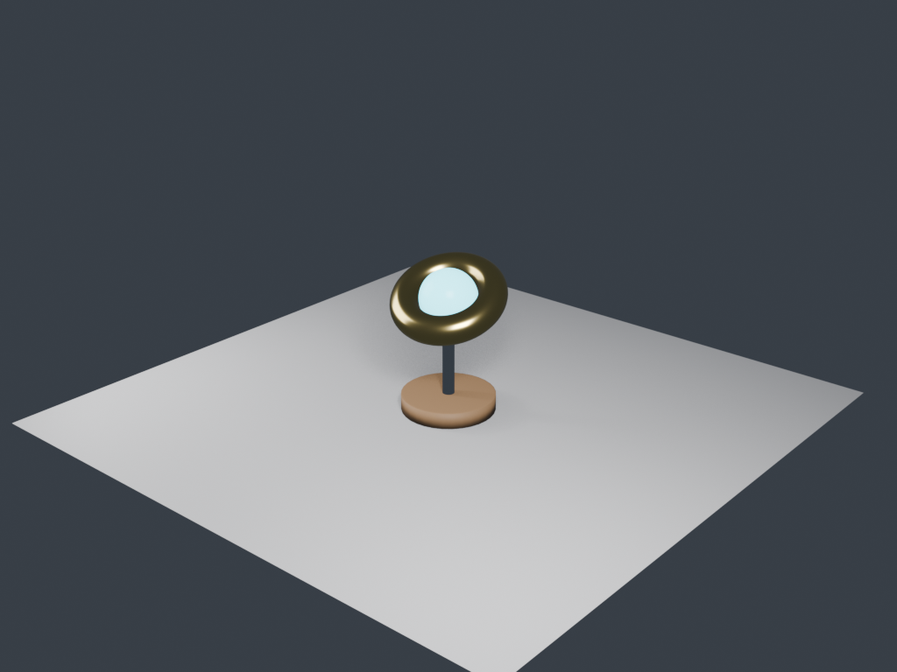
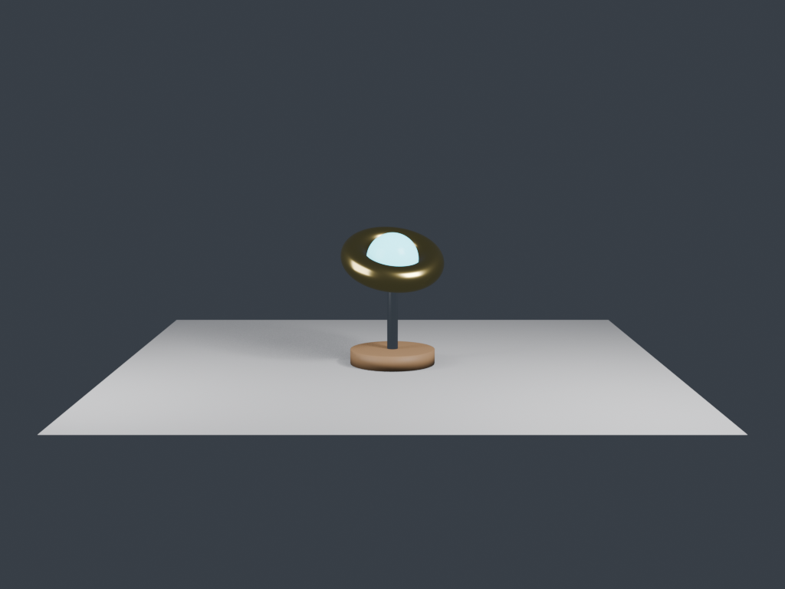

# cracion AN — Servidor MCP y Estudio de Escritorio para Blender 5.2

**cracion AN** es un servidor **MCP (Model Context Protocol)** en TypeScript —acompañado de una aplicación nativa de escritorio en Windows (WPF)— que conecta a un asistente de IA con **Blender 5.2 LTS** instalado en tu computador.

Permite crear escenas `.blend` con iluminación de estudio, agregar objetos 3D con materiales PBR, ejecutar modelado paramétrico en Python (`bpy`), inspeccionar geometría, renderizar vistas previas PNG con `BLENDER_EEVEE`, exportar modelos listos para web o impresión 3D (`.glb`, `.obj`, `.fbx`, `.stl`) y abrir los proyectos directamente en la interfaz gráfica de Blender o desde la aplicación de escritorio `CracionAN`.

---

## Documentación del Examen

| Entregable | Documento |
|---|---|
| Utilidad académica (máx. 1 página) | [`docs/utilidad-academica.md`](docs/utilidad-academica.md) |
| Demostración de caso real ("antes y después") y guion de demo | [`docs/demostracion-caso-real.md`](docs/demostracion-caso-real.md) |
| Declaración de uso de IA, límites conocidos y seguridad | [`docs/uso-ia-y-seguridad.md`](docs/uso-ia-y-seguridad.md) |

---

## Vista previa de resultados generados por el MCP

Escena *"Prototipo de Luminaria Modular de Estudio"* creada íntegramente mediante llamadas MCP a **Blender 5.2.1 LTS** (ver detalle en [`docs/demostracion-caso-real.md`](docs/demostracion-caso-real.md)):

| Vista en Perspectiva (`1024×768`) | Vista Frontal (`1024×768`) |
|---|---|
|  |  |

---

## Arquitectura y vía de integración

Siguiendo buenas prácticas de integración (*API local → CLI → archivos → scripting → UI*):

1. **Vía principal — CLI de Blender en modo headless (`blender --background --factory-startup --python`)**: Blender no expone una API HTTP nativa sin instalar complementos externos, pero su CLI oficial ejecuta scripts `bpy` de forma robusta, rápida y reproducible sin bloquear la interfaz gráfica.
2. **Paso seguro de parámetros**: toda entrada validada con `zod` se serializa como JSON en la variable de entorno `CRACION_AN_PARAMS` (nunca se concatena texto del usuario en código Python ni se invoca un shell).
3. **Aplicación nativa de escritorio en Windows**: [`app-windows/CracionAN.ps1`](app-windows/CracionAN.ps1) ofrece una ventana WPF nativa (sin navegador web) que opera sobre los mismos archivos `.blend` y Blender 5.2.
4. **Carpeta de trabajo acotada**: todos los archivos se almacenan dentro de `<Escritorio>\cracion-AN` (configurable con `CRACION_AN_DIR`).

---

## Requisitos

- **Node.js 18 o superior** (verificado en Node.js 24).
- **Blender 5.2 LTS** (compatible con `BLENDER_EEVEE`, `wm.obj_export` y `wm.stl_export`).
  - Se detecta automáticamente en `C:\Program Files\Blender Foundation\Blender 5.2\blender.exe` (Windows) o mediante `blender` en `PATH`.
  - Si lo instalaste en otra ruta, define la variable de entorno `BLENDER_PATH`.
- **Windows 10/11** si deseas usar además la aplicación de escritorio WPF (`Abrir-cracion-AN.bat`). El servidor MCP funciona en Windows, macOS y Linux.
- Un cliente compatible con MCP: **OpenCode**, **Antigravity**, **Claude Desktop** o **Cursor**.

---

## Instalación paso a paso

```bash
# 1. Clonar el repositorio
git clone https://github.com/gaostolaza2007-dotcom/cracion.git cracion-an
cd cracion-an

# 2. Instalar dependencias
npm install

# 3. Compilar TypeScript a dist/
npm run build

# 4. Ejecutar prueba de humo MCP (verifica handshake y las 9 herramientas)
npm test
```

> **Nota en Windows PowerShell**: si tu sistema restringe scripts `.ps1`, utiliza `npm.cmd install`, `npm.cmd run build` y `npm.cmd test`.

### Prueba integral (E2E) sobre Blender 5.2

Para verificar el flujo completo (crear escena, agregar mallas, ejecutar `bpy`, inspeccionar, renderizar 2 PNG, exportar GLB/STL y validar seguridad):

```bash
npm run demo
```

### Abrir la aplicación de escritorio (Windows)

Haz doble clic en [`Abrir-cracion-AN.bat`](Abrir-cracion-AN.bat) o ejecuta:

```bash
npm run app
```

---

## Conectar el MCP a tu cliente de IA

### OpenCode

El archivo [`opencode.json`](opencode.json) ya viene configurado con el servidor `cracion-an`. También puedes registrar la ruta absoluta automáticamente:

```bash
npm run configurar
```

### Antigravity / Claude Desktop / Cursor

Agrega el servidor `cracion-an` en tu archivo de configuración MCP (por ejemplo `~/.gemini/config/mcp_config.json` en Antigravity):

```json
{
  "mcpServers": {
    "cracion-an": {
      "command": "node",
      "args": [
        "<RUTA-ABSOLUTA-AL-REPO>/dist/index.js"
      ]
    }
  }
}
```

### Variables de entorno opcionales

No se requiere ninguna clave API ni credencial. Opcionalmente puedes definir en tu entorno o cliente MCP (ver [`.env.example`](.env.example)):

- `BLENDER_PATH`: ruta manual al ejecutable `blender.exe` / `blender`.
- `CRACION_AN_DIR`: carpeta personalizada para proyectos `.blend`, renders y exportaciones (por defecto `<Escritorio>/cracion-AN`).

---

## Herramientas MCP incluidas (9)

| Herramienta | Qué hace | Tipo |
|---|---|---|
| `abrir_programa_cracion_an` | Abre la aplicación nativa de escritorio `CracionAN` en Windows, opcionalmente cargando un `.blend`. | Escritura |
| `listar_proyectos_blend` | Lista los archivos `.blend`, renders `.png` y exportaciones en `cracion-AN` (con filtro opcional). | Solo lectura |
| `inspeccionar_escena_blend` | Abre un `.blend` en Blender 5.2 en segundo plano y devuelve objetos, dimensiones, vértices, caras y materiales. | Solo lectura |
| `crear_escena_blend` | Crea un proyecto `.blend` nuevo con iluminación de estudio de 3 puntos y cámara (`vacia`, `estudio_producto` o `composicion_base`). Nunca sobrescribe existentes. | Escritura |
| `agregar_objeto_3d` | Agrega `cubo`, `esfera`, `cilindro`, `cono`, `toroide`, `plano`, `texto_3d` o `luz_area` con posición, rotación, escala, material PBR y subdivisión. | Escritura |
| `ejecutar_python_blender` | Ejecuta un script Python (`bpy`) personalizado sobre un `.blend` existente y guarda los cambios. | Escritura |
| `renderizar_vista_blend` | Renderiza un `.png` en `BLENDER_EEVEE` encuadrando automáticamente el modelo (`perspectiva`, `frontal`, `posterior`, `lateral_derecha`, `lateral_izquierda`, `superior`, `camara_escena`). | Escritura |
| `exportar_modelo_3d` | Exporta un `.blend` a formato `.glb`, `.obj`, `.fbx` o `.stl`. | Escritura |
| `eliminar_archivo_blend` | Elimina permanentemente un archivo dentro de `cracion-AN`. Exige `confirmar: true`. | **Destructiva** |

---

## Ejemplos de uso en lenguaje natural

Una vez conectado el MCP a tu asistente de IA, puedes pedirle directamente:

1. **Crear un prototipo desde cero:**
   > *"Crea una escena nueva llamada `maqueta_stand` con plantilla `estudio_producto`, agrega una esfera metálica dorada y un texto 3D encima."*
2. **Inspeccionar geometría antes de entregar o imprimir:**
   > *"Inspecciona `prototipo_luminaria.blend` y dime cuántos vértices, caras y materiales tiene cada objeto."*
3. **Generar vistas de presentación y exportar:**
   > *"Renderiza `prototipo_luminaria` en vista perspectiva y vista frontal a 1024 px, y expórtalo a GLB para la web y STL para impresión 3D."*
4. **Aplicar modelado fino con Python (`bpy`):**
   > *"Aplica un modificador Bevel de 3 segmentos a `Base_Madera` en `prototipo_luminaria.blend` y vuelve a renderizar."*
5. **Abrir la aplicación de escritorio:**
   > *"Abre `prototipo_luminaria.blend` en el programa cracion AN para revisarlo visualmente."*

---

## Estructura del repositorio

```text
app-windows/
  CracionAN.ps1              Aplicación de escritorio nativa (WPF) para Blender 5.2
src/
  index.ts                   Punto de entrada del servidor MCP (stdio)
  lib/
    blender.ts               Localización de Blender 5.2, rutas seguras y ejecución sin shell
    blender_scripts.ts       Plantillas Python (bpy) para estudio, materiales PBR, render y export
    exec.ts                  Wrapper seguro con execFile (sin shell)
    respuestas.ts            Helpers MCP: texto(), json(), error()
  tools/
    blender_mcp.ts           Registro de las 9 herramientas MCP validadas con zod
scripts/
  smoke-test.mjs             Prueba de humo automatizada (npm test)
  demo-examen.mjs            Prueba integral E2E sobre Blender 5.2 (npm run demo)
docs/
  utilidad-academica.md      Justificación académica (máx. 1 página)
  demostracion-caso-real.md  Caso real "antes y después" con renders y métricas reales
  uso-ia-y-seguridad.md      Declaración de uso de IA, límites y seguridad
  evidencia/                 Renders PNG generados por el MCP en Blender 5.2
Abrir-cracion-AN.bat         Lanzador directo de la app en Windows
opencode.json                Configuración lista para OpenCode
```

---

## Comandos principales

| Comando | Descripción |
|---|---|
| `npm run build` | Compila TypeScript en `dist/` |
| `npm test` | Compila y ejecuta la prueba de humo MCP (`scripts/smoke-test.mjs`) |
| `npm run demo` | Ejecuta el flujo completo E2E en Blender 5.2 (`scripts/demo-examen.mjs`) |
| `npm run app` | Abre la aplicación de escritorio nativa `CracionAN` (Windows) |
| `npm run inspect` | Abre el MCP Inspector web para probar cada herramienta manualmente |

---

## Licencia

MIT — ver [`LICENSE`](LICENSE).
