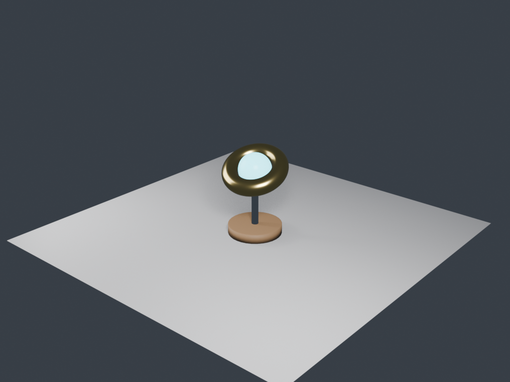
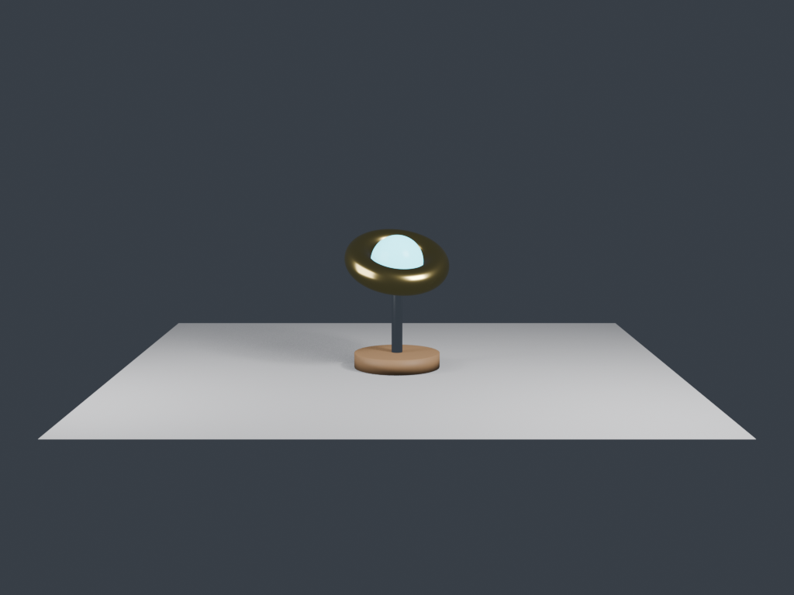

# Demostración con Caso Real: Flujo "Antes y Después"

## Caso académico auténtico

**Tarea:** Preparar el prototipo tridimensional de un producto de estudio (**"Prototipo de Luminaria Modular de Estudio"**) compuesto por una base de madera biselada, un mástil cromado, un aro metálico dorado y un difusor esférico emisivo sobre un plano de presentación, auditando su geometría, generando dos láminas renderizadas (vista perspectiva y vista frontal en `1024×768`) y exportando el modelo tanto en `.glb` (para visor web/presentación) como en `.stl` (para impresión 3D).

> Esta demostración completa es 100% reproducible en cualquier computador con Node.js 18+ y Blender 5.2 ejecutando `npm run demo` ([`scripts/demo-examen.mjs`](../scripts/demo-examen.mjs)).

---

## Comparativa "Antes y Después"

| Etapa de la tarea | Antes (flujo manual en Blender) | Después (con **cracion AN** MCP + Blender 5.2) |
|---|---|---|
| **Preparar escena e iluminación** | Borrar escena inicial, crear 3 luces de área, ajustar energías, tamaños y orientaciones, configurar fondo y cámara manualmente (~5–8 min). | 1 llamada a `crear_escena_blend`: crea cámara y estudio de 3 luces automáticamente (**19.8 s**). |
| **Modelar piezas y materiales PBR** | Crear cada primitiva, ajustar coordenadas/escalas, activar *Smooth Shading*, abrir *Shader Editor* y configurar 4 materiales `Principled BSDF` uno por uno (~10–15 min). | 4 llamadas a `agregar_objeto_3d` con coordenadas, rotaciones, subdivisión y presets PBR (**~30.9 s** en total). |
| **Detalle de acabado y suelo** | Añadir plano de presentación, material y modificador `BEVEL` manual en la base (~3 min). | 1 llamada a `ejecutar_python_blender` con `bpy` (**5.2 s**). |
| **Auditoría de geometría** | Seleccionar objeto por objeto en *Overlays / Statistics* para anotar vértices, caras y dimensiones (~2 min). | 1 llamada a `inspeccionar_escena_blend`: JSON exacto con 5 mallas, 1,190 vértices y 1,157 caras (**6.3 s**). |
| **Renderizar 2 vistas de lámina** | Mover y reencuadrar la cámara manualmente para perspectiva y luego para vista frontal, configurar resolución `1024×768` y guardar cada PNG (~5–8 min). | 2 llamadas a `renderizar_vista_blend` (`perspectiva` y `frontal`), con encuadre automático por *bounding box* (**15.8 s** y **12.0 s**). |
| **Exportar a web e impresión 3D** | Ir a *File → Export → glTF 2.0 (.glb)* y repetir para *STL (.stl)* verificando rutas (~2 min). | 2 llamadas a `exportar_modelo_3d` (`glb` y `stl`) (**13.2 s** y **11.6 s**). |
| **Tiempo operativo total** | **~27 a 38 minutos** de operación manual repetitiva. | **~1 minuto 56 segundos** (`116.3 s` medidos extremo a extremo), reproducible y sin errores de ruta. |

---

## Registro verificable paso a paso (ejecución real en Blender 5.2.1 LTS)

### Paso 1 — Pedido a la IA: crear la escena y ensamblar el prototipo
> *"Crea una escena llamada `prototipo_luminaria` con iluminación de estudio y arma un prototipo de luminaria: una base cilíndrica de madera cálida, una columna cromada, un aro dorado inclinado y una esfera emisiva cyan en la parte superior."*

**Herramientas ejecutadas por el MCP:**
1. `crear_escena_blend({ nombre: "prototipo_luminaria", plantilla: "vacia" })` → `19.8 s` · creó cámara `Camara_Principal` y 3 luces (`Luz_Principal`, `Luz_Relleno`, `Luz_Contorno`).
2. `agregar_objeto_3d` × 4:
   - `Base_Madera` (`cilindro`, `madera_calida`, pos `[0, 0, -0.55]`, escala `[1.1, 1.1, 0.14]`) → `5.6 s`
   - `Columna_Cromada` (`cilindro`, `metal_cromado`, pos `[0, 0, 0.05]`, escala `[0.14, 0.14, 0.85]`) → `5.4 s`
   - `Aro_Dorado` (`toroide`, `oro`, pos `[0, 0, 0.72]`, rot `[25, 0, 15]`, escala `[0.78, 0.78, 0.78]`, subdiv `1`) → `11.5 s`
   - `Difusor_Luz` (`esfera`, `emisivo_cyan`, pos `[0, 0, 0.72]`, escala `[0.52, 0.52, 0.52]`, subdiv `1`) → `8.4 s`

### Paso 2 — Pedido a la IA: añadir base de presentación y biselado técnico
> *"Agrega un suelo blanco de estudio bajo la base en Z = -0.65 y aplica un modificador Bevel de 3 segmentos a `Base_Madera`."*

**Herramienta ejecutada:**
- `ejecutar_python_blender` sobre `prototipo_luminaria` → `5.2 s` · añadió `Suelo_Presentacion` (`Mat_Blanco_Estudio`) y modificador `BEVEL` (`width = 0.03`, `segments = 3`).

### Paso 3 — Pedido a la IA: auditar la escena antes de exportar
> *"Inspecciona `prototipo_luminaria.blend` y muéstrame sus objetos, dimensiones y conteo de vértices."*

**Resultado real devuelto por `inspeccionar_escena_blend` (`6.3 s`, Blender 5.2.1 LTS):**

| Objeto | Material | Dimensiones (m) | Vértices | Caras |
|---|---|---|---:|---:|
| `Aro_Dorado` | `Mat_Oro` | `1.357 × 1.357 × 0.343` | 576 | 576 |
| `Difusor_Luz` | `Mat_Emisivo_Cyan` | `0.676 × 0.676 × 0.676` | 482 | 512 |
| `Base_Madera` | `Mat_Madera_Calida` | `1.100 × 1.100 × 0.196` | 64 | 34 |
| `Columna_Cromada` | `Mat_Metal_Cromado` | `0.140 × 0.140 × 1.190` | 64 | 34 |
| `Suelo_Presentacion` | `Mat_Blanco_Estudio` | `7.000 × 7.000 × 0.000` | 4 | 1 |
| **Total (5 mallas + 3 luces + 1 cámara)** | — | — | **1,190** | **1,157** |

### Paso 4 — Pedido a la IA: generar láminas PNG y exportar a GLB y STL
> *"Renderiza `prototipo_luminaria` en perspectiva y en vista frontal a 1024 px, y expórtalo a GLB y STL."*

**Resultados reales generados por Blender 5.2 (`BLENDER_EEVEE`):**
- `renderizar_vista_blend` (`perspectiva`, `1024×768`) → `15.8 s` · **`704.8 KB`**
- `renderizar_vista_blend` (`frontal`, `1024×768`) → `12.0 s` · **`683.5 KB`**
- `exportar_modelo_3d` (`glb`) → `13.2 s` · **`64.0 KB`**
- `exportar_modelo_3d` (`stl`) → `11.6 s` · **`449.8 KB`**
- `listar_proyectos_blend` → `49 ms` · verificó los 6 archivos en la carpeta de trabajo (`prototipo_luminaria.blend` = `130 KB`).
- Verificación de seguridad: `eliminar_archivo_blend` rechazó el borrado sin `confirmar: true` y eliminó el archivo de prueba solo al enviar `confirmar: true` (`5 ms`).

#### Evidencia visual generada directamente por el MCP

| Vista Perspectiva | Vista Frontal |
|---|---|
|  |  |

---

## Guion breve para demostración en vivo o video (60–90 segundos)

1. **0:00–0:15 — Verificación técnica:** ejecutar `npm test` en la terminal para mostrar que el servidor MCP compila y expone las 9 herramientas sin errores.
2. **0:15–0:45 — Pedido natural al asistente IA:** pedirle crear una escena nueva o agregar un objeto a `prototipo_luminaria.blend` y renderizar una vista (mostrar el llamado a las herramientas MCP y la respuesta JSON de Blender 5.2).
3. **0:45–1:10 — App nativa y Blender real:** abrir [`Abrir-cracion-AN.bat`](../Abrir-cracion-AN.bat) (o usar `abrir_programa_cracion_an`) para mostrar la ventana nativa de Windows con la vista previa renderizada y pulsar **"Abrir en Blender 5.2"** para demostrar que el archivo `.blend` es 100% real y editable en Blender.
4. **1:10–1:30 — Cierre:** mostrar los archivos generados (`.blend`, `.png`, `.glb`, `.stl`) en la carpeta `cracion-AN` y resumir el ahorro de tiempo del flujo antes vs. después.
